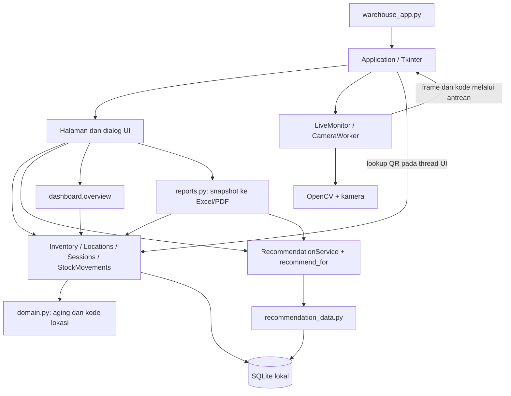

# Arsitektur Warehouse Check / SPARK

Dokumentasi kondisi kode per **4 Oktober 2026**. Paket Windows: **1.0.1**. Skema SQLite: **7**. SPARK adalah nama konsep/presentasi; judul aplikasi dan executable masih Warehouse Check.

Mulai dari [Panduan Pengembang](docs/PANDUAN_PENGEMBANG.md) untuk pemasangan, pengujian, dan build. Dokumen ini menjelaskan bagaimana komponen terhubung; rincian aturan ada pada dokumen khusus.

## 1. Tujuan dan batas sistem

Aplikasi desktop membantu petugas melihat umur dan lokasi barang, mengenali prioritas pemeriksaan, membaca QR, mencatat hasil serta keputusan petugas, dan mengekspor laporan. Data tersimpan di SQLite lokal. Rekomendasi Site/Customer memakai aturan dan skenario simulasi; belum berupa model AI yang dilatih.

| Fungsi | Perilaku yang sudah ada |
|---|---|
| Dashboard | Statistik batch berstok, prioritas, aktivitas sesi, peta lokasi, navigasi section/kolom/tingkat |
| Data Barang | Pencarian/filter, tambah/edit, detail, label QR, impor/ekspor, barang keluar, riwayat pengeluaran |
| Master lokasi | Area/rak/kolom/baris/tingkat; 27 alamat per rak pada model saat ini |
| Pengecekan | Draft per petugas, input ID/QR, snapshot hasil, catatan, pemeriksaan fisik, keputusan dan tujuan |
| Laporan | Riwayat/filter, detail, catatan draft, preview PDF, ekspor Excel/PDF berbasis hasil sesi |
| Live | Satu kamera; beberapa QR per frame bila terbaca; overlay dan panel informasi sementara |
| Rekomendasi | Saran berdasarkan aging, kebutuhan site, dan kecocokan customer; petugas menentukan tindakan |

Tidak ada proses pencarian kerusakan barang dari gambar. Kamera membaca QR dan mengambil informasi dari master. Lokasi pada peta berasal dari data barang, bukan pengukuran lokasi fisik oleh kamera. Live tidak membuat sesi, laporan, atau riwayat deteksi tersimpan.

## 2. Susunan komponen

Ini pembagian tanggung jawab kode yang ada, bukan arsitektur web/backend. Belum ada HTTP API atau server terpisah. Sebagian query dan pengayaan data juga berada pada `ui.py`, `dashboard.py`, dan service rekomendasi; lapisan repository generik belum dibuat.

### Titik masuk dan startup

1. [warehouse_app.py](warehouse_app.py) memproses `--verify-package <laporan.json>` bila diberikan. Tanpa argumen tersebut, buat `tk.Tk()` dan `Application(root)`.
2. [Application](warehouse/ui.py) membuka database lewat `connect()`, menjalankan `seed_demo()`, membuat `Inventory`, dan membuat pengelola Live.
3. `connect()` memvalidasi penanda database demo, melakukan migrasi bila diperlukan, dan mengaktifkan foreign key.
4. `seed_demo()` hanya mengisi data jika metadata `seed_date` belum ada. Database kosong menghasilkan **50 batch dan 162 lokasi**. Paket rilis sudah memiliki seed berbeda sehingga langkah ini tidak mengulang pengisian.
5. Shell membuat navigasi, membuka Dashboard, lalu menjadwalkan pengecekan pergantian hari dan polling Live melalui `root.after()`.
6. `Application.close()` menghentikan kamera, membatalkan timer, menutup koneksi, dan menghancurkan jendela. Worker melepaskan perangkat melalui blok `finally`.

Kegagalan startup ditampilkan melalui kotak pesan oleh entry point. Belum ada sistem log operasional terpusat.

## 3. Peta modul untuk pengembang

| Kebutuhan perubahan | Modul utama | Pendamping |
|---|---|---|
| Batas aging, rumus umur, format alamat | [domain.py](warehouse/domain.py) | [database.py](warehouse/database.py), tes domain/migrasi |
| Schema dan migrasi | [database.py](warehouse/database.py) | [runtime_paths.py](warehouse/runtime_paths.py) |
| Data barang/validasi | [inventory.py](warehouse/inventory.py) | [batch_ui.py](warehouse/batch_ui.py), [inventory_table.py](warehouse/inventory_table.py) |
| Master lokasi | [locations.py](warehouse/locations.py) | [location_ui.py](warehouse/location_ui.py) |
| QR dan label | [labels.py](warehouse/labels.py) | [label_ui.py](warehouse/label_ui.py) |
| Template, validasi massal, impor/ekspor | [inventory_excel.py](warehouse/inventory_excel.py) | [excel_ui.py](warehouse/excel_ui.py) |
| Sesi dan snapshot | [sessions.py](warehouse/sessions.py) | [session_ui.py](warehouse/session_ui.py) |
| Saran, keputusan, tindak lanjut | [recommendations.py](warehouse/recommendations.py) | [recommendation_data.py](warehouse/recommendation_data.py), `session_ui.py` |
| Pengeluaran stok | [stock_movements.py](warehouse/stock_movements.py) | [stock_ui.py](warehouse/stock_ui.py) |
| Agregasi dan denah | [dashboard.py](warehouse/dashboard.py) | [dashboard_ui.py](warehouse/dashboard_ui.py), [rack_map.py](warehouse/rack_map.py) |
| Kamera pengecekan | [camera.py](warehouse/camera.py) | [camera_ui.py](warehouse/camera_ui.py) |
| Live dan pelacakan deteksi sementara | [live_monitor.py](warehouse/live_monitor.py) | [live_ui.py](warehouse/live_ui.py), `ui.py` |
| Laporan dan preview | [reports.py](warehouse/reports.py) | [report_ui.py](warehouse/report_ui.py) |
| Shell, tema, navigasi, detail barang | [ui.py](warehouse/ui.py) | [visuals.py](warehouse/visuals.py), folder `assets/warehouse/` |
| Seed pengujian dan distribusi | [create_trial_data.py](scripts/create_trial_data.py) | [build_windows.py](scripts/build_windows.py), [package_check.py](warehouse/package_check.py) |

## 4. Tiga jenis informasi yang harus dibedakan

| Informasi | Sumber | Kapan berubah |
|---|---|---|
| Inventory dan aging terkini | `batches` + `locations` + tanggal komputer | Saat master diperbarui atau tanggal berganti |
| Hasil pengecekan | `check_results.snapshot`, umur/status/waktu cek | Dicatat saat pertama batch ditambahkan ke sesi; scan ulang dalam sesi tidak memperbarui snapshot |
| Keputusan dan tindak lanjut | `recommendation_decisions` + `recommendation_completions` | Keputusan bisa direvisi selama Draft; penyelesaian tindakan dicatat terpisah |

Dashboard/Data Barang/Live memakai status terkini dengan batas default 30/90 hari. Sesi memiliki batas umur sendiri. Laporan memakai data historis saat cek dan keputusan yang tersimpan. Perbedaan status antartampilan dapat benar secara bisnis; jangan menyeragamkannya dengan membaca master terbaru ke laporan lama.

Detail rekomendasi juga memiliki dua waktu: saran saat cek dan saran saat keputusan disimpan. Lihat [Sistem Rekomendasi](docs/SISTEM_REKOMENDASI.md) untuk pemetaan persis pada setiap tampilan.

## 5. Alur fitur

### Barang, label, pengecekan, laporan

```mermaid
flowchart LR
    Input[Form barang / Excel] --> Validate[Validasi inventory dan lokasi]
    Validate --> Master[(Master batch)]
    Master --> Label[QR berisi ID batch]
    Label --> Scan[Input ID / scan gambar / kamera]
    Scan --> Confirm[Tambah atau konfirmasi hasil]
    Confirm --> Session[Sessions.add_code]
    Session --> Snapshot[(Snapshot hasil sesi)]
    Snapshot --> Physical[Pemeriksaan fisik oleh petugas]
    Physical --> Decision[Simpan keputusan dan tujuan]
    Decision --> Finish[Selesaikan sesi]
    Finish --> Report[Laporan Excel / PDF]
```

Keputusan fisik tidak wajib untuk setiap hasil agar sesi bisa selesai. Diagram menunjukkan alur lengkap yang tersedia, bukan kewajiban otomatis pada setiap langkah. Rekomendasi sendiri sudah dapat dibaca dari Dashboard/Data Barang tanpa scan.

### Live

Kamera → worker capture/decode → antrean frame terbaru → pengelola track sementara → thread UI mencocokkan kode ke batch → aging/rekomendasi terkini → overlay dan daftar Live. Pindah halaman tidak menghentikan Live. Kamera pengecekan meminta perangkat yang sama; aplikasi mengelola jeda dan kelanjutan Live agar dua worker tidak berebut kamera. Rincian ada di [Antarmuka dan Kamera](docs/ANTARMUKA_DAN_KAMERA.md).

### Barang keluar

`StockMovements.issue()` memvalidasi input, mengurangi stok dalam transaksi, dan menyimpan bukti pengeluaran beserta snapshot. Batch stok nol tetap memiliki ID dan riwayat. Menandai rekomendasi selesai **tidak** memanggil pengeluaran stok secara otomatis.

## 6. Batas thread dan penyimpanan

- Tk dan koneksi SQLite milik aplikasi utama digunakan pada thread UI. Jangan meneruskan koneksi itu ke worker kamera.
- Kamera mengerjakan capture/decode di thread latar; data dikonsumsi UI melalui antrean/polling. Excel membaca file di worker, sedangkan validasi/simpan melalui UI/service.
- File QR/gambar kamera yang digunakan pengguna tidak otomatis menjadi arsip foto. Frame Live berada di memori. Gambar cek terakhir di Dashboard juga hanya memori untuk sesi proses aplikasi tersebut.
- File ekspor ditulis melalui file sementara sebelum mengganti tujuan. Database memakai transaksi dan trigger untuk melindungi riwayat tertentu.
- SQLite memakai foreign key dan `busy_timeout=5000`. Ini tidak menjadikan aplikasi sistem multiuser atau sinkronisasi antarperangkat.

## 7. Lokasi data dan artefak

| Lokasi | Peran |
|---|---|
| `data/warehouse_demo.db` | Database ketika kode Python dijalankan; dapat berisi data pengguna/pengembangan |
| `data_uji/warehouse_demo_seed.db` | Fixture simulasi 200 batch dengan satu sesi buatan PETUGAS-SIMULASI untuk tes; penyiapan demo menyalin master dan membersihkan riwayat |
| `Aplikasi_Warehouse_Check_Rekomendasi_Final/data/warehouse_demo.db` | Database executable yang terpisah dari database sumber |
| `Aplikasi_Warehouse_Check_Rekomendasi_Final/_internal/` | Python/dependensi/aset bundled; bukan tempat menyimpan transaksi |
| `assets/warehouse/` | Aset visual yang ikut dibundel |
| `outputs/` | Presentasi, gambar, manual, dan keluaran lain; bukan kode aplikasi |
| `arsip/` | Prototipe, sumber data lama, dan cadangan rilis; jangan dianggap seluruhnya aman dihapus |
| `.build/` | Lingkungan build, staging, cache, bukti pengujian; `.build/venv` dipakai build yang terakhir |

[Runtime paths](warehouse/runtime_paths.py) membuat database frozen mengikuti lokasi executable, bukan current working directory. Memindahkan `.exe` saja akan kehilangan dependensi/data yang diperlukan; paket harus dipindahkan sebagai satu folder.

## 8. Batas saat serah terima dan arah perubahan

| Batas aktual | Implikasi bagi pekerjaan berikutnya |
|---|---|
| Rule-based dengan kebutuhan Site/Customer simulasi | Jangan menamai skor/aturan sebagai hasil training; ubah sumber konteks melalui kontrak yang jelas bila data nyata tersedia |
| Satu kamera lokal | Belum ada UI konfigurasi RTSP/IP CCTV atau banyak kamera serentak |
| 3 kolom × 3 baris × 3 tingkat | Batas berada di domain, schema, migrasi, UI, dan tes; tidak cukup memperbesar gambar |
| Keputusan hanya melalui sesi Pengecekan | Tombol keputusan langsung pada Dashboard/Data Barang belum ada |
| Nama petugas berupa input teks | Tidak ada login, role, atau bukti autentikasi petugas |
| Edit stok master tersedia | Riwayat `stock_movements` mencatat alur Barang Keluar; bukan ledger lengkap semua perubahan stok/master |
| Tidak ada API/sinkronisasi SAP | Sumber, paket, dan perangkat lain tidak berbagi perubahan otomatis |
| Aging mengikuti jam komputer | Tidak berjalan sebagai scheduler terpisah saat aplikasi ditutup; dihitung kembali saat dibuka |
| Belum ada snapshot inventory harian | Tidak ada seri historis stok/demand yang cukup untuk klaim predictive analytics |

Saat menambah fitur, gunakan service yang sama dari form, impor, dan scan. Pertahankan ID batch, riwayat sesi, dan pemisahan keputusan dari perubahan stok. Perubahan schema memakai migrasi baru, bukan reset database pengguna. Daftar tes dan prosedur rilis ada di [Panduan Pengembang](docs/PANDUAN_PENGEMBANG.md).
