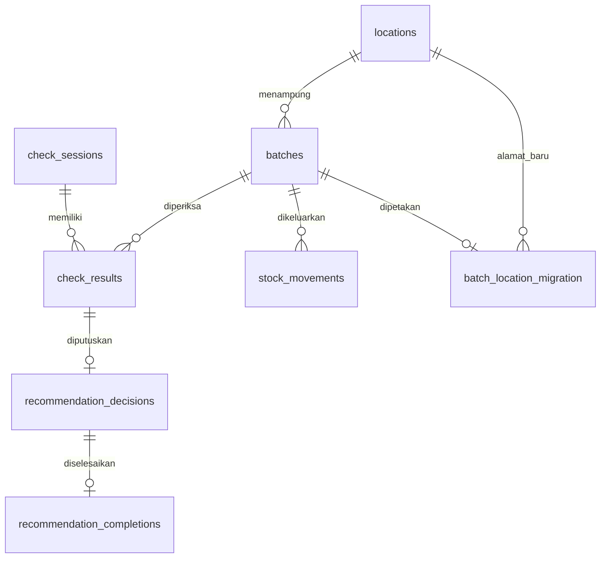

# Data dan aturan bisnis

> Salinan untuk repository GitHub. Setup dan data demo repository dijelaskan pada [README](../README.md); path executable/.build dalam dokumen ini mengacu pada workspace asal.

Dokumen pengembang ini menjelaskan perilaku kode pada 4 Oktober 2026 untuk paket Windows **1.0.1** dan **skema SQLite 7**.
Nomor versi aplikasi dan nomor skema berbeda; rujukan skema adalah `SCHEMA_VERSION` pada [database.py](../warehouse/database.py).

## 1. Database dan identitas data

[runtime_paths.py](../warehouse/runtime_paths.py) memilih `data/warehouse_demo.db` relatif terhadap akar sumber saat menjalankan Python, atau folder executable saat menjalankan paket.
Database sumber dan database paket adalah salinan terpisah; perubahan pada salah satunya tidak disinkronkan.
`connect()` mengaktifkan foreign key, menetapkan `busy_timeout=5000`, dan memakai `sqlite3.Row`.
Kode tidak mengaktifkan mode WAL, tetapi mekanisme backup mendukung isi WAL yang sudah committed.

| Sumber data | Isi awal yang menjadi rujukan | Makna |
| --- | --- | --- |
| `seed_demo()` pada kode | 50 batch, 6 rak, 162 lokasi | Seed minimal untuk database baru dan banyak tes |
| `data/warehouse_demo.db` | 56 batch awal menurut README/manifest | Data kerja sumber Python; dapat berubah selama penggunaan |
| `data_uji/warehouse_demo_seed.db` | 200 batch, 12 rak, 324 lokasi | Seed skenario uji; bukan database aktif paket |
| Database awal paket 1.0.1 | 200 batch; 0 sesi, hasil pengecekan, dan keputusan | Salinan instalasi bersih untuk pengguna baru |

Angka paket berasal dari manifest paket (`../Aplikasi_Warehouse_Check_Rekomendasi_Final/manifest_paket.json`; referensi workspace asal), bukan jumlah yang dijamin tetap setelah pemakaian.
`seed_demo()` hanya bekerja jika `metadata.seed_date` belum ada; tanggal penerimaan tidak digeser setiap aplikasi dibuka.
Database scanner lama bernama `warehouse.db` tidak otomatis dibuka atau ditafsirkan sebagai database aplikasi ini.

`plant` dan `storage_location` adalah field master berupa teks; kode tidak memiliki kamus arti/kepanjangan `BHT` atau `PBHT`. Keduanya berbeda dari alamat rak fisik `location_code` dan label Site A/B/C pada konteks rekomendasi. Tidak ada pemetaan otomatis plant ke site; pengembang harus mempertahankan perbedaan ini saat menambahkan sumber data.

**Identitas utama adalah batch penerimaan, bukan material.**
`batches.id` unik dan menjadi sasaran QR, hasil pengecekan, transaksi keluar, serta tindak lanjut.
Material seperti `MAT-001` atau `00072` dapat muncul pada beberapa batch, termasuk tanggal dan lokasi yang sama.
Penambahan manual selalu membuat `BAT-` diikuti 32 digit heksadesimal UUID huruf besar.
Seed menggunakan ID seperti `DEMO-0001`; impor dapat membawa ID eksternal seperti `EXT-002`.
Mengubah material, lokasi, tanggal, atau stok melalui `Inventory.update()` tidak mengganti ID batch.

## 2. Tabel, field, dan relasi

Definisi SQL lengkap, indeks, dan trigger ada di [database.py](../warehouse/database.py).
`PK` berarti primary key; `FK` berarti foreign key yang benar-benar dideklarasikan di SQLite.

| Tabel | Kunci dan field penting | Relasi/batasan utama |
| --- | --- | --- |
| `metadata` | PK `key`; `value` teks | `mode=demo`, `seed_date`, dan `last_check` berupa JSON untuk aktivitas terakhir |
| `locations` | PK `code`; `area`, `rack`, `column`, `row`, `level` | Kombinasi koordinat unik; setiap sumbu bilangan 1–3 |
| `batches` | PK `id`; `material`, `description`, `plant`, `storage_location`, `location_code`, `received_date`, `stock` | FK lokasi; material tidak kosong; SQL membatasi stok nonnegatif |
| `check_sessions` | PK integer `id`; `officer`, `area`, `started_at`, `finished_at`, `status`, `normal_max`, `age_limit`, `note` | Status `Draft`/`Selesai`; waktu selesai hanya terisi untuk `Selesai`; batas aging disimpan per sesi |
| `check_results` | PK gabungan `session_id,batch_id`; `checked_at`, `snapshot`, `age`, `status`, `note` | FK sesi dan batch; maksimal satu hasil per batch dalam satu sesi |
| `stock_movements` | PK `id`; `batch_id`, `occurred_on`, `recorded_at`, `quantity`, `stock_before`, `stock_after`, `officer`, `note`, `snapshot` | FK batch; JSON valid; `stock_before-stock_after=quantity`; riwayat tidak dapat diedit/dihapus |
| `batch_location_migration` | PK/FK `batch_id`; `old_location_code`, `new_location_code`, `migrated_at` | FK lokasi baru; alamat lama berupa teks historis; diisi saat migrasi v4 |
| `recommendation_decisions` | PK integer `id`; `session_id`, `batch_id`, `physical_condition`, `choice`, `reason`, `officer`, `decided_at`, `age_at_decision`, `aging_status`, `recommendation_snapshot`, `target_kind`, `target_code` | Pasangan sesi/batch unik dan FK ke hasil pengecekan; snapshot JSON valid |
| `recommendation_completions` | PK/FK `decision_id`; `officer`, `completed_at`, `note` | Maksimal satu penyelesaian per keputusan; tidak dapat diedit/dihapus |
| `site_demand` | PK `material,site`; `demand_prev`, `demand_now`, `open_demand`, `site_stock` | Site `A/B/C`; empat nilai numerik berupa integer nonnegatif |
| `material_unit_compatibility` | PK `material,unit_model` | Material dan model unit tidak kosong |
| `customer_demand` | PK `customer,unit_model`; `open_demand` | Customer `A/B/C`; demand integer nonnegatif |

Tiga tabel demand/kompatibilitas tidak mempunyai FK ke `batches`: penghubungnya adalah nilai material/model unit pada layanan rekomendasi.
`check_results.snapshot` disimpan sebagai teks JSON oleh layanan, tetapi kolom ini tidak memiliki `CHECK(json_valid(...))` seperti snapshot transaksi dan keputusan.
Tidak ada tabel master material, tabel stok per material, atau constraint satu batch per lokasi.



Diagram hanya menampilkan relasi FK; metadata dan tabel bukti rekomendasi sengaja dijelaskan dalam tabel di atas.
Indeks eksplisit membantu pencarian batch per lokasi, lokasi per area/rak, transaksi per batch/waktu, keputusan per batch/waktu, serta kompatibilitas per model unit.

## 3. Lokasi rak 3 × 3 × 3

Format alamat adalah `AREA-RAK-Kxx-Rxx-Txx`, contohnya **`A-B03-K02-R03-T01`**.
Artinya Area A, Rak B03, Kolom 02, Baris 03, Tingkat 01.
Area hanya satu huruf A–Z; rak satu huruf A–Z diikuti dua angka; K/R/T masing-masing 01–03.
Satu rak memiliki 27 alamat; kode rak dan area dinormalisasi menjadi huruf besar oleh layanan lokasi.
`parse_location()` menerima teks integer, tetapi menolak nilai desimal atau di luar 1–3.

`Locations.create_rack()` mengisi seluruh 27 alamat dengan `INSERT OR IGNORE`, sehingga aman diulang untuk rak parsial.
`Locations.add()` memvalidasi alamat pilihan lalu membuat seluruh rak; alamat yang sudah ada ditolak.
Batch hanya boleh memilih alamat yang sudah terdaftar melalui `Locations.require()`.
Tidak ada pemeriksaan kapasitas fisik atau larangan beberapa batch memakai alamat yang sama.

Konversi impor lama menggunakan `legacy_code_to_new()`:

```text
A-B01-03-02  ->  A-B01-K02-R01-T03
tingkat 03      posisi lama 02 menjadi kolom 02; baris ditetapkan 01
```

Konversi memerlukan area dan rak lengkap; kode dengan tingkat/posisi lama 04 ditolak.
Ini **berbeda dari migrasi v4**, yang menyebar ulang batch di rak semula dan mencatat pemetaannya.
Rujukan: [domain.py](../warehouse/domain.py), [locations.py](../warehouse/locations.py), dan [tes lokasi](../test_locations.py).

## 4. Aging terkini dan aging sesi

[domain.aging()](../warehouse/domain.py) menghitung selisih hari antara tanggal acuan dan `received_date`.
Tanggal masa depan ditolak. Batas standar adalah `NORMAL_MAX=30` dan `AGE_LIMIT=90`.

| Umur dengan batas standar | Status |
| --- | --- |
| 0–30 hari, termasuk hari ke-30 | `Normal` |
| 31–90 hari, termasuk hari ke-90 | `Warning` |
| Lebih dari 90 hari | `Melewati batas` |

Contoh tes pada 16 September 2026: penerimaan `2026-08-17` berstatus Normal; `2026-08-16` Warning; `2026-06-17` Melewati batas.
`Inventory.list_batches()` menghitung ulang umur/status saat dibaca, menggunakan hari ini kecuali `today` diberikan.
Tanggal master yang rusak menghasilkan umur `—` dan status `Data perlu diperbaiki` pada daftar inventory.
Stok nol tetap mempertahankan batch dan umur; filter `active` memilih stok > 0, sedangkan `empty` memilih stok = 0.

Sesi menyimpan batasnya sendiri: `0 <= normal_max < age_limit <= 365000`, keduanya integer.
Contoh sesi dengan batas 3/7 menjadikan barang umur 10 hari `Melewati batas`, walaupun status standar masih Normal.
Hasil sesi menyimpan umur/status pada waktu cek; membuka laporan lama tidak menghitung ulang umur menggunakan hari ini.
Status aging bukan penilaian kondisi fisik. Kondisi `Layak`, `Perlu evaluasi`, atau `Tidak layak` dicatat terpisah oleh petugas.

## 5. Validasi batch dan impor Excel

[Inventory.validate()](../warehouse/inventory.py) dipakai oleh tambah, edit, dan preview impor.

- Material, deskripsi, plant, dan storage location wajib berisi 1–200 karakter setelah trim.
- Lokasi wajib terdaftar; input dinormalisasi menjadi huruf besar.
- Tanggal masuk harus tanggal kalender valid dalam bentuk `YYYY-MM-DD` dan tidak melebihi hari ini.
- Stok harus bentuk integer tanpa tanda/desimal, 0–999999999; teks `-1`, `1.5`, atau sepuluh digit ditolak.
- `BatchValidationError.field` memberi tahu UI kolom mana yang gagal.

Edit dapat membawa `expected_stock`; pembaruan hanya berhasil jika stok database masih sama dengan nilai itu.
Jika stok sudah berubah, layanan meminta formulir dibuka ulang. Perlindungan ini opsional bagi pemanggil dan hanya membandingkan stok.
Mengedit master stok secara langsung melalui `Inventory.update()` tidak menghasilkan baris audit barang keluar.

[inventory_excel.py](../warehouse/inventory_excel.py) hanya menerima `.xlsx` dengan sheet `Inventory` dan header wajib berikut:

```text
Batch ID | Material | Material Description | Plant | Storage Location | Location Code | GR Date | Total Stock
```

Pembaca memetakan kolom berdasarkan nama header; urutan di atas adalah urutan template.
Header hilang atau duplikat ditolak; kolom tambahan seperti `Aging (days)`, `Status`, dan `As of` tidak diimpor.
Batasnya 5000 baris data setelah header; baris kosong dilewati, tetapi posisi baris tetap dihitung terhadap batas.
Rumus dan error Excel pada kolom input ditolak; tanggal Excel diubah menjadi ISO, dan stok float bulat seperti `3.0` dinormalisasi menjadi integer.
Batch ID, material, plant, storage location, dan kode lokasi harus sel teks agar nol di depan tidak hilang.
Alamat empat bagian diterjemahkan saat preview dengan pemberitahuan, lalu diperiksa keberadaannya di master lokasi.

Aturan duplikasi impor:

1. Batch ID eksplisit harus cocok `[A-Za-z0-9][A-Za-z0-9_-]{0,99}` dan belum ada di file/database.
2. ID kosong dibuatkan `BAT-...`; isi seluruh field selain ID dibandingkan setelah normalisasi, trim, dan `casefold()`.
3. Baris tanpa ID yang identik dengan data lama atau baris sebelumnya ditolak; penerimaan terpisah yang identik harus diberi ID unik eksplisit.
4. Impor selalu menambah; ID lama tidak digunakan untuk memperbarui master.

`commit_import()` mengambil write lock melalui `BEGIN IMMEDIATE`, menjalankan preview ulang, lalu menyimpan seluruh baris dalam satu transaksi.
Satu kesalahan atau duplikasi membatalkan seluruh impor; preview yang sebelumnya bersih tidak menjamin commit jika data telah berubah.
Ekspor inventory memuat seluruh master, bukan filter layar, serta sheet `Lokasi` dan `Petunjuk`.
Teks ekspor ditulis sebagai teks Excel, termasuk deskripsi yang diawali `=`; file disimpan melalui file sementara lalu `os.replace()`.
Rujukan tes: [inventory](../test_inventory.py) dan [impor/ekspor](../test_inventory_excel.py).

## 6. Identitas QR dan kompatibilitas data lama

[labels.payload()](../warehouse/labels.py) menghasilkan **`ID:<batch_id>`**, misalnya `ID:DEMO-0001`.
Payload tidak menyimpan material, stok, umur, atau lokasi; scan mengambil master batch terkini dari database yang sedang digunakan.
ID wajib berupa string tidak kosong, tanpa spasi tepi, maksimum 100 karakter.
`resolve()` mengharuskan prefiks `ID:` dan mencari ID secara tepat; `MAT-001`, ID terpotong, dan ID yang tidak ada ditolak.
Tidak ada fallback QR berdasarkan material atau lokasi; QR dari database berbeda hanya berhasil jika ID itu juga tersedia di database aktif.
Input manual `Sessions.add_code()` boleh berupa ID mentah, karena layanan menambahkan prefiks `ID:` setelah trim.
Label tetap memakai payload yang sama setelah master diedit atau label dicetak ulang; teks lokasi pada label lama dapat menjadi usang.

Fallback data lama terjadi di tempat lain: konversi alamat impor pada bagian 3 dan rekonstruksi saran laporan lama pada bagian 7.
[Tes label](../test_labels.py) memeriksa decode gambar QR, kestabilan setelah edit/restart, dan penolakan lookup yang tidak tepat.

## 7. Snapshot sesi, laporan, dan penguncian

[Sessions.start()](../warehouse/sessions.py) membuat sesi Draft dengan petugas/area masing-masing 1–100 karakter.
Area sesi berupa keterangan teks; tidak ada FK atau pembatasan scan hanya ke master lokasi di area tersebut.
Nomor tampilan laporan seperti `CHK-000001` berasal dari ID integer sesi.
Saat batch pertama kali ditambahkan, layanan menyimpan waktu lokal ber-offset, seluruh field master, umur/status, dan `recommendation_at_check` dalam snapshot.
Rekomendasi saat cek ikut merekam konteks demand yang tersedia pada saat itu.
Scan ulang batch pada sesi yang sama mempertahankan waktu dan snapshot pertama serta mengembalikan penanda `False` untuk hasil baru.
Scan ulang tetap memperbarui `metadata.last_check`; penanda aktivitas ini bukan hasil pengecekan tambahan.
Catatan sesi atau hasil maksimal 2000 karakter dan hanya dapat disimpan ketika sesi Draft.

`finish()` memerlukan setidaknya satu hasil, mengisi `finished_at`, dan mengubah status menjadi `Selesai`.
Trigger SQLite menolak perubahan/penghapusan sesi selesai dan insert/update/delete hasil yang terkait sesi selesai.
Trigger juga menolak penyelesaian sesi kosong; penguncian tidak hanya bergantung pada tombol UI.
Draft dapat dibuka kembali setelah restart. Layanan tidak menyediakan fungsi membuka ulang sesi yang sudah selesai.

[reports.report_data()](../warehouse/reports.py) membaca hasil dari snapshot, bukan join ulang ke master inventory.
Perubahan material, lokasi, tanggal, stok, atau demand setelah cek tidak mengubah fakta pengecekan yang tersimpan.
Untuk hasil lama tanpa `recommendation_at_check`, fallback memanggil `recommend_for()` memakai snapshot lama, tanggal `checked_at`, dan batas sesi tanpa demand terkini.
Fallback itu dihitung saat laporan dibaca; perubahan algoritme rekomendasi di versi mendatang dapat mengubah teks saran lama yang belum punya snapshot saran.
`generated_at` adalah waktu ekspor/pembuatan laporan, sehingga dapat berbeda walaupun fakta hasilnya tetap sama.

Keputusan petugas terpisah dari saran saat cek: layanan menyimpan snapshot rekomendasi dari master terkini saat keputusan dibuat, menggunakan batas sesi.
Keputusan hanya boleh dibuat untuk batch yang sudah dicek di sesi Draft dan masih punya stok; satu batch tidak boleh memiliki tindak lanjut terbuka lain.
Keputusan dapat dikoreksi selama Draft dan belum diselesaikan; penghapusan keputusan selalu ditolak trigger.
Pilihan v7 `Pindahkan ke site` harus membawa `target_kind=site`; `Tawarkan ke customer` memakai `target_kind=customer`, keduanya dengan `target_code` terisi.
Pilihan lama tidak boleh membawa target; pilihan tujuan harus tersedia dalam rekomendasi terkini dan barang harus dinyatakan Layak.
Penyelesaian tindak lanjut boleh dicatat setelah sesi selesai, tanpa mengubah keputusan asli, stok, atau lokasi.
Laporan mengambil field keputusan yang tetap, bukan status penyelesaian yang kemudian berubah; ini menjaga isi hasil laporan setelah tindakan dituntaskan.
Pencatatan selesai tidak mengeksekusi pemindahan barang atau mengirim penawaran ke customer.
Rujukan: [recommendations.py](../warehouse/recommendations.py), [tes sesi](../test_sessions.py), dan [tes laporan rekomendasi](../test_recommendation_reports.py).

## 8. Barang keluar dan jejak audit

[StockMovements.issue()](../warehouse/stock_movements.py) mewajibkan batch, jumlah integer 1–999999999, tanggal keluar valid, dan petugas 1–100 karakter.
Tanggal keluar tidak boleh sebelum tanggal masuk atau setelah hari ini; catatan opsional maksimal 2000 karakter.
Jumlah tidak boleh melebihi stok terkini; stok nol tetap menyisakan batch agar QR dan riwayatnya tersedia.
Layanan menolak pemanggilan ketika koneksi sedang memiliki transaksi lain yang belum selesai.

Urutan transaksi adalah `BEGIN IMMEDIATE` → baca stok → validasi → kurangi stok → simpan audit → commit.
Kegagalan penyimpanan audit juga mengembalikan stok melalui rollback; dua koneksi tidak dapat mengeluarkan stok berdasarkan saldo lama yang sama.
Audit memuat `OUT-` + UUID 32 digit, tanggal kejadian, waktu pencatatan, jumlah, stok sebelum/sesudah, petugas, catatan, dan snapshot master sebelum pengurangan.
Trigger menolak seluruh update/delete audit; perubahan master kemudian tidak mengubah identitas barang pada riwayat transaksi.

`operation_id` mendukung retry: ID sama dengan payload yang sama mengembalikan transaksi sebelumnya tanpa pengurangan kedua.
ID sama dengan batch/jumlah/tanggal/petugas/catatan berbeda ditolak; pemanggil harus mempertahankan ID operasi untuk retry yang aman.
Tanpa `operation_id`, setiap panggilan membuat ID baru sehingga bukan retry idempoten.
[Tes barang keluar](../test_stock_movements.py) mencakup rollback, pengeluaran bersamaan, retry bersamaan, histori tetap, dan migrasi.

## 9. Migrasi 1–7 dan perlindungan data

`connect()` membaca `PRAGMA user_version`; versi di atas 7 ditolak agar aplikasi lama tidak mengolah skema lebih baru.
Versi 0 hanya boleh database tanpa tabel; database tak dikenal yang sudah memiliki tabel ditolak.
Database dikenali melalui `metadata.mode=demo`. Ini penanda format aplikasi, bukan mekanisme autentikasi.

| Versi tujuan | Perubahan |
| --- | --- |
| 1 | Membuat metadata, lokasi lama dengan `level/position`, batch, dan indeks lokasi batch |
| 2 | Menambah sesi, hasil snapshot, batas aging per sesi, serta trigger penguncian/larangan selesai kosong |
| 3 | Menambah audit barang keluar, validasi stok sebelum/sesudah, dan trigger histori tidak dapat diubah |
| 4 | Mengganti lokasi menjadi 27 alamat per rak; memperbarui lokasi master batch dan menyimpan peta alamat lama/baru |
| 5 | Menambah keputusan rekomendasi, penyelesaian, relasi ke hasil, dan trigger perlindungan keputusan |
| 6 | Menambah demand site, kompatibilitas material/model unit, dan demand customer |
| 7 | Membangun ulang tabel keputusan untuk pilihan Site/Customer serta `target_kind/target_code`; mempertahankan ID dan penyelesaian lama |

Untuk database yang sudah berversi 1–6, satu backup dibuat **sebelum rangkaian migrasi** melalui API SQLite `db.backup()`.
Namanya `<nama.db>.pre-v<versi-asal>-<timestamp-UTC>.bak`, bersebelahan dengan database asal; isi WAL yang committed ikut tercakup.
Database baru versi 0 dan pembukaan normal versi 7 tidak memicu backup migrasi.
Setiap tahap mempunyai transaksi sendiri; kegagalan tahap berikutnya tidak membatalkan tahap sebelumnya yang sudah committed.

V4 mempertahankan area/rak, mengurutkan batch per rak menurut ID, lalu memilih alamat dengan offset `(index * 10) % 27`.
Pemetaannya tidak mempertahankan posisi lama secara langsung; `batch_location_migration` menyediakan jejak per batch.
Lokasi lama dengan tingkat/posisi di luar 1–3 atau batch tanpa lokasi valid membatalkan tahap ini.
Snapshot sesi dan transaksi lama tetap memuat alamat historis; jangan menggantinya dengan alamat master baru.
V4 dan v7 mematikan FK hanya selama penggantian tabel, memeriksa `foreign_key_check` dan `integrity_check` sebelum commit, lalu mengaktifkan FK kembali.

Untuk mempertahankan data, lanjutkan perubahan skema melalui migrasi baru; jangan mengganti database aktif dengan seed/paket bersih atau mengubah ID batch.
Jangan menurunkan `user_version` secara manual, menghapus `seed_date`, atau menonaktifkan trigger untuk memperbaiki riwayat.
Backup migrasi bukan backup berkala. Simpan salinan data aktif dan uji upgrade pada salinan sebelum mengganti paket pengguna.
Validasi layanan lebih ketat daripada beberapa constraint SQL; penulisan SQL langsung dapat melewati validasi tanggal, teks, dan aturan tindak lanjut.
Bukti regresi: [tes fondasi/migrasi v4](../test_foundation.py), [migrasi v1](../test_sessions.py), [migrasi v2](../test_stock_movements.py), serta [migrasi v5/v6→v7](../tests/test_recommendation_data.py).
